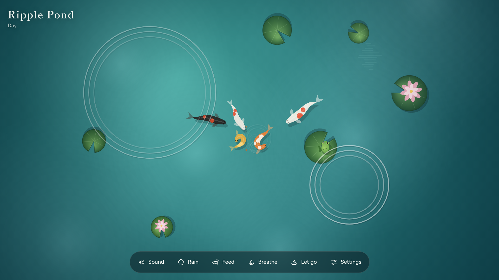

# Ripple Pond

A calm koi pond for the browser. Tap the water and watch ripples spread while soft notes play. There is no score, no timer and no way to lose. It is made for anyone who wants a few quiet minutes, on a phone or a computer.

**Play it: https://thinukalehan.github.io/ripple-pond/**

It installs like an app (on a phone: browser menu → *Add to Home Screen*; on a computer: the install icon in the address bar) and works offline after the first visit.



## How to play

| Do this | What happens |
| --- | --- |
| Tap the water | A pebble drops, ripples spread, and a note plays. Taps near the middle sound deeper, near the edges higher. |
| Hold for half a second | A bigger stone with a deeper sound and wider ripples. |
| Drag your finger | A trail of small ripples. A koi follows your finger. |
| Tap the frog | It hops to another lily pad. |
| Tap a resting dragonfly | It darts away. |
| **Feed**, then tap the water | A pinch of food scatters and the koi race over to eat it. |
| **Breathe** | A guided breathing session with a lotus that opens as you breathe in and closes as you breathe out (1, 3 or 5 minutes). |
| **Let go** | Write a worry, put it on a paper boat, and watch it drift away and sink. Nothing you write is saved. |
| **Settings** | Sound style, volumes, time of day, and sleep mode. |
| Keyboard | Enter or Space drops a pebble (Shift for a big stone). Escape closes panels and wakes from sleep mode. |

## What's in the pond

- **Koi** that wander, gather where you tap, and race to food.
- **Lily pads** that bob when ripples reach them, some with lotus flowers.
- **A frog** that hops, blinks, croaks (more in the evening and in rain) and catches fireflies at night.
- **A dragonfly** that visits during the day, hovers, dips into the water and rests on lily pads.
- **Day and night** that follow your own clock: morning mist, bright day, sunset glow, and a night pond with moonlight, stars and fireflies.
- **Rain**, with raindrop ripples, quiet notes and rain sound.
- **Sound**: four note styles (Chimes, Kalimba, Singing bowl, Water drops), all in a pentatonic scale so any tapping sounds musical. Gentle water sounds, birds by day, crickets and a distant frog chorus at night.
- **Sleep mode**: 15, 30 or 60 minutes. The pond plays by itself, the screen dims, the sound fades out at the end, and the screen stays awake until the timer ends.

All sound is generated in the browser, so there are no audio files. Settings are remembered in your browser only, and the game collects nothing ([privacy policy](https://thinukalehan.github.io/ripple-pond/privacy.html)).

On iPhone, sound only plays when silent mode is off. Browsers start sound only after the first tap.

## Running it locally

The built website is in `docs/`. Serve that folder with any local web server, for example:

```
python -m http.server 8000 --directory docs
```

then open http://localhost:8000. Opening `docs/index.html` directly also works, but offline mode and installing need a web server.

## Project layout

```
src/ripple-pond.html        The game: one file with styles, markup and script.
src/privacy.html            Privacy policy page.
assets/icon.svg             App icon artwork.
assets/icons/               App icons rendered from icon.svg (scripts/make_icons.py).
assets/screenshots/         App store screenshots (scripts/make_screenshots.py).
assets/fonts/               Bundled fonts (SIL Open Font License).
scripts/build.mjs           Builds the website into docs/.
docs/                       The built website, served by GitHub Pages. Do not edit by hand.
tests/smoke_test.py         Plays every feature and checks install and offline play.
PUBLISHING.md               How to publish on itch.io, the Microsoft Store and Google Play.
TODO.md                     Ideas and planned work.
```

The game source is a page fragment (no `<html>`, `<head>` or `<body>` tags) that loads Google Fonts, so the same file can also be published as a Claude artifact. The build wraps it into a complete page, swaps in the bundled fonts, and adds the app manifest and the offline service worker.

## Making changes

1. Edit `src/ripple-pond.html`.
2. Build: `node scripts/build.mjs` (Node 18 or newer, no packages needed).
3. Test: `python tests/smoke_test.py` (first time only: `pip install playwright` and `python -m playwright install chromium`).
4. Commit the source and `docs/`, then push. GitHub Pages updates the live site within a minute or two, and installed copies update themselves the next time they open online.

If the icon artwork changes, run `python scripts/make_icons.py`. If the look of the game changes, refresh the store screenshots with `python scripts/make_screenshots.py`, then build again.

## Technical notes

- Plain HTML, CSS and JavaScript. No frameworks and no runtime dependencies. Fonts: Shippori Mincho and Figtree.
- The pond is drawn on a 2D canvas. Sound uses the Web Audio API with a generated reverb.
- Installable web app: a manifest plus a service worker that caches the game for offline play. The cache name is a hash of the files, so every new build replaces the old cache automatically.
- The animation clock slows down gracefully on slow devices, while the breathing guide and sleep timer use real time so their seconds stay accurate.
- Respects reduced-motion settings, pauses sound when the tab is hidden, and uses a screen wake lock only during sleep mode.
